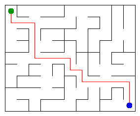

# Assignment 3. Maze Escape

Student ID: 251220
Name: Batyushkin Maxim
Group: SE-2510
Maze size (rows x columns): 9x11

This file is the report. Fill it in as you go. How to start: `START_HERE.md`. The task: `docs/Assignment3.pdf`.

## Program output

The 13 lines your program prints on your data (`java -cp out Main`):

    Broken: 98
    Kept: 80
    Last broken wall: 142
    MST cost: 30141
    Heaviest broken wall: 748
    Path length: 18
    DFS visited: 62
    Dead ends: 32
    Zones: 8
    Largest zone: 21
    Is DAG: 0
    Flow stages: 5
    Fastest route cost: 4

My maze:

## Questions

Answer in your own words, two or three sentences each.

Mission 0. What do find and union do, and what makes them fast in your code?
    find search root of the cell, which set contains some x, union joins a and b sets, by set parent of root of smaller set is parent of bigger
    fast because in union, we hang smaller one to bigger one
    after find all cells in the path will attach direct to the corner

Mission 1. Why is Broken always R*C - 1, and Kept always (R-1)*(C-1)?
    in the beginning we have R*C groups, we need one, every succesful union reduce number of groups by one, that means we need to do R*C-1 succesfull unions
    we have (R-1)*C+R(C-1) walls, we will broke RC-1, others stay

Mission 2. My MST cost from Kruskal and from Prim, and why they are equal:
            30141
            both of methods are greedy, both of them takes the cheapest wall, that's not create a cycle
            in task we have information that all prices are different, that means we have only one minimum tree

Mission 3. Why is there exactly one path between two cells? How did you avoid a stack overflow on a huge maze?
    
maze is connected (all cells are joined) and it has R*C-1 open walls, so it is a tree, there are no cycles
if there were two different paths between two cells, together they would make a cycle
to avoid stack overflow I do not use recursion, I use my own array stack and a counter top,
recursion on 1000x1000 would go about a million calls deep

Mission 4. Why does the second pass of Kosaraju go on the reversed graph? Why do the slides have no cycle exactly when Zones equals the number of cells?

the cell that finished last in the first pass lies in a zone where no slides come from other zones
if we go from it on reversed slides, we find only cells of its own zone
if we went on normal slides, we would leak to the next zones and take extra cells
zone is cells which can reach each other, so they lie on a common cycle
if Zones = number of cells, every zone is one cell, so no two cells are on a common cycle, no cycle at all
if there is a cycle, its cells go to one zone, so zones are fewer than cells

Mission 5. Why is it enough to go through the zones in the order of their numbers? What does this pass cost?

zones are numbered so that every slide goes from a smaller number to a bigger number
so when we reach a zone, all slides into it are already checked, and its dist and stages are final
priority queue is needed when we do not know the final value in advance, here we know it from the order
we look at every zone and every slide once, so it costs O(Z + S), Z is zones, S is slides

## AI use
Claude (Anthropic). Used to explain the ideas (DSU, Kruskal, Prim, DFS, Kosaraju,
topological order), to explain errors, and to help with code (Prim, DFS, Kosaraju,
route in the zone graph). I went through each method step by step and can explain it.

The syllabus requires you to say which AI tools you used and for what. Write the tool (ChatGPT, Copilot, other) and what you asked it: explain an idea, find an error, review code. Write "none" if you did not use any. If you took code or text from a book or a website, give the source here.

## Timing (Mission 7)

Milliseconds, 5 runs each, from `java -cp out Bench`.

| maze | Kruskal | Prim |
|---|---------|------|
| 100 x 100 | 19      | 12   |
| 300 x 300 | 98      | 119  |
| 1000 x 1000 | 1728    | 3799 |

What do the numbers say about how the time grows? Two or three sentences.

Maze grows 100 times from 100x100 to 1000x1000, Kruskal time grows about 90 times, Prim about 300 times.
Kruskal is faster on the big maze, Prim is slower because it creates many objects for the queue.
Numbers are noisy (Prim had a run of 8641 ms), because of garbage collector and JVM warm-up.

## Complexity

n is the number of cells, m the number of walls (or slides). Fill in every algorithm you wrote.

| algorithm | time                | space  | assumptions |
|---|---------------------|--------|-------------|
| DSU find and union | O(a(n)) almost O(1) | O(n)   | union by size, path compression            |
| Kruskal | 0(mlogm)            | O(m)   |       sort walls by cost, then m DSU operations      |
| Prim | 0(mlogm)            | 0(n+m) |     binary heap (PriorityQueue), each wall enters it at most twice        |
| DFS | 0(n)                | 0(n)   |      maze is a tree (n-1 open walls), own stack, no recursion       |
| Kosaraju | O(n+s)              | O(n+s) |          two passes, each visits every cell and slide once   |
| Route in the zone graph | O(Z+S)              | O(Z+S) |     zones are in topological order, no priority queue        |

n-cells
m-walls
S-slide
Z-zones
## Before you submit

- data/walls.txt, data/slides.txt and output/maze.png are in the repository.
- `java tools/Check.java` shows all examples right.
- This README is filled in, the program output and the section AI use included.
- The work is pushed to main (at least one commit per mission) and the repository is public.
- The link is attached in Moodle.
